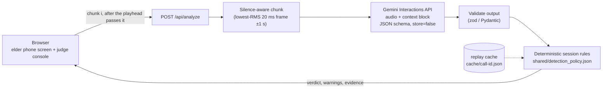

# Saavdhan (સાવધાન / सावधान)

[](https://github.com/RakshitSathvara/GDGGarbathon/actions/workflows/ci.yml)

**Mid-call scam warnings for elders, in Gujarati and Hindi.** Saavdhan listens to a phone call in
short, silence-aligned chunks with Gemini audio understanding and warns an elderly or first-time
smartphone user *while the call is still happening* — naming the exact red flags it heard and
telling them what to do next: hang up, call **1930**, report on **cybercrime.gov.in**.

---

## The problem

"Digital arrest", fake bank KYC and fake courier scams reach elders through ordinary voice calls.
The caller impersonates the police, CBI, a bank or a courier company, invents an emergency, isolates
the victim ("don't tell anyone, don't cut the call") and then asks for an OTP, an app install or a
money transfer. Victims usually realise what happened only after the call ends — and the warnings
they do get are in English, generic, and arrive too late.

A useful defence therefore has to:

1. **understand** the call as it happens, in the languages elders actually speak;
2. **explain** its verdict with evidence a person can verify, instead of an opaque score;
3. **speak** to the listener simply, in their own language, in a way they can perceive;
4. **act** before the first demand for money or an OTP — and point to real help.

## How Saavdhan addresses it — understand · converse · act

| Need | What Saavdhan does | Where |
| --- | --- | --- |
| Understand the call live | Cuts audio into ~6 s chunks at natural pauses and sends each chunk to Gemini *only after the playhead has passed it*, with a running context block of everything heard so far. Transcribes Gujarati in Gujarati script and Hindi in Devanagari. | [`server/wav.ts`](server/wav.ts), [`app/chunker.py`](app/chunker.py), [`prompts/detector_system.md`](prompts/detector_system.md) |
| Explain, don't just score | Structured output lists evidence *before* the verdict: each red flag has a type (authority claim, urgency, threat, OTP, money, remote access, secrecy, hand-off) and a **verbatim quote**. Every SCAM warning cites a quote that was actually heard. | [`shared/chunk_schema.json`](shared/chunk_schema.json) |
| Stay reliable when the model wavers | Deterministic floors on top of the model: a hard red flag ⇒ risk ≥ 75; authority + threat + urgency ⇒ ≥ 70; once SCAM, always SCAM. A failed request is shown as *unavailable* — never as a guessed verdict. | [`shared/detection_policy.json`](shared/detection_policy.json) |
| Converse in the listener's language | ≥ 28 px high-contrast warning in Gujarati or Hindi, optional read-aloud (`gu-IN` / `hi-IN` speech), screen-reader announcements, and an alert beep on the first SCAM verdict. | [`static/`](static/) |
| Act in time | One-tap **Call 1930** (National Cyber Crime Helpline) and **Report on cybercrime.gov.in** appear the moment a call is judged a scam; the judge console proves how many seconds *before the caller's first demand* the warning fired. | [`static/index.html`](static/index.html) |
| Bring your own calls | Upload any `.wav` (≤ 10 MB); it is converted to 16 kHz mono PCM and becomes a playable call. | `POST /api/upload` |

### Demo calls

| Call | Scam pattern | Expected verdict |
| --- | --- | --- |
| `digital_arrest.wav` | Fake CBI & customs officers, arrest warrant, secrecy | SCAM |
| `fake_kyc.wav` | "Your account will be blocked", OTP demand | SCAM |
| `fake_courier.wav` | Illegal parcel in your name, hand-off to "police" | SCAM |
| `genuine_bank.wav` | Real bank: passbook update, "visit the branch", never asks for an OTP | SAFE |

---

## Architecture



Saavdhan ships **two interchangeable backends behind one HTTP contract**:

- **Node / Express** — [`server.ts`](server.ts) + [`server/`](server/). Runs in Google AI Studio and on
  Cloud Run (`npm run dev`), with a fallback model for availability.
- **Python / FastAPI** — [`app/`](app/). Runs with `uvicorn` or on serverless hosts (it falls back to
  a temp directory on read-only filesystems) and powers the offline evaluator
  [`scripts/eval.py`](scripts/eval.py), which never switches models so comparisons stay honest.

Both load the same [`shared/chunk_schema.json`](shared/chunk_schema.json) (the exact structured-output
schema sent to Gemini) and [`shared/detection_policy.json`](shared/detection_policy.json) (thresholds,
floors, fallback warnings). Contract tests replay the same fixtures in
[`tests/fixtures/`](tests/fixtures/) through both implementations, so they cannot drift — including
identical chunk boundaries, which keeps replay caches recorded by the Python evaluator aligned with
the Node server.

### Repository layout

```
server.ts               Node entrypoint (config → app → listen)
server/                 app.ts (routes) · config · detector (Gemini) · rules · wav · calls · upload
                        · sessions · replay · security · validation · types
app/                    FastAPI mirror: main · config · detector · rules · chunker · storage
                        · sessions · replay · security
static/                 index.html · css/app.css · js/{app,view,api,helpers,i18n,dom,feedback}.js
shared/                 chunk_schema.json · detection_policy.json (single source of truth)
prompts/                detector_system.md (system prompt)
scripts/                prep.sh (ffmpeg) · eval.py (evaluation CLI) · build.mjs (static bundle)
calls/                  demo recordings (16 kHz mono PCM) + manifest.json; raw/ originals
tests/node/             140 unit + HTTP integration tests (node:test)
tests/python/           112 unit + API tests (pytest)
tests/e2e/              Chromium end-to-end + axe-core accessibility audit (Playwright)
tests/fixtures/         cross-language contract fixtures
```

---

## Quick start

### Node (Google AI Studio / Cloud Run)

```bash
npm install
cp .env.example .env        # set GEMINI_API_KEY
npm run dev                 # http://localhost:3000
```

### Python

```bash
python3 -m venv .venv && source .venv/bin/activate
pip install -r requirements.txt
cp .env.example .env        # set GEMINI_API_KEY
uvicorn app.main:app --host 0.0.0.0 --port 8000
```

**Replay mode** serves `cache/<call>.json` at the recorded latency (with a REPLAY badge), so the demo
works offline: start either server with `DEMO_REPLAY=1`, or toggle **LIVE / REPLAY** in the UI.

### Audio prep

Place raw recordings (any format) in `calls/raw/` and run `bash scripts/prep.sh` (needs `ffmpeg`). It
converts every file to 16 kHz mono 16-bit PCM WAV in `calls/`.

### Evaluation CLI

```bash
python3 scripts/eval.py                                   # all calls → cache/<call>.json + summary table
python3 scripts/eval.py --call digital_arrest --print-transcript
python3 scripts/eval.py --model gemini-3.5-flash-lite --thinking-level minimal
```

The evaluator exits non-zero if any scam call fails to reach SCAM, the genuine call leaves SAFE, or a
SCAM verdict is not backed by a quote that appears in the transcript.

### Configuration

| Variable | Default | Purpose |
| --- | --- | --- |
| `GEMINI_API_KEY` | — | Gemini API key. Read only on the server; never sent to the browser. |
| `MODEL` | Node `gemini-3.5-flash-lite`, Python `gemini-3.8-flash` | Model for live analysis / evaluation. `.env.example` sets `gemini-3.8-flash` for both. |
| `THINKING_LEVEL` | `low` (3.8 Flash) / `minimal` | `minimal`, `low`, `medium` or `high`; 3.8 Flash never receives `minimal`. |
| `CHUNK_SEC` | `6.0` | Target chunk length, clamped to 3–30 s. |
| `DEMO_REPLAY` | `0` | `1` serves recorded results from `cache/`. |
| `PORT` / `HOST` | `3000` / `0.0.0.0` | Node listen address. |
| `TRUST_PROXY` | `1` | Reverse-proxy hops to trust for client IPs (rate limiting). |
| `FRAME_ANCESTORS` | unset | Space/comma-separated CSP `frame-ancestors` allow-list (e.g. `'self'`). Unset keeps the app embeddable in the AI Studio preview. |

---

## Quality, testing and CI

Every push runs [`.github/workflows/ci.yml`](.github/workflows/ci.yml):

| Check | Command | What it guarantees |
| --- | --- | --- |
| Lint & types | `npm run lint` | Strict TypeScript (`noUncheckedIndexedAccess`, no `any`) for server, tests and e2e; Biome lint + format for TS, JS, CSS, HTML and JSON. |
| Node tests | `npm run test:coverage` | 140 unit + HTTP integration tests; CI fails below 90 % lines / 85 % branches / 90 % functions (currently ≈ 99.9 / 93.9 / 98.8 %). |
| Python | `ruff check . && ruff format --check . && python -m pytest` | Ruff (incl. bandit security rules) and 112 tests; CI fails below 90 % coverage (currently ≈ 98 %). |
| End-to-end | `npm run test:e2e` | Real Chromium against the real app under its CSP: plays a scam call, asserts the SCAM escalation, actions, highlighted evidence and language switching, with zero console errors. |
| Accessibility | (inside e2e) | axe-core WCAG 2.2 A/AA + best-practice audit of the idle **and** SCAM states must report zero violations. |
| Contracts | (inside both suites) | Shared schema enums, policy, session-rule scenarios, context blocks and chunk boundaries are identical across Node and Python. |
| Supply chain | `npm audit --omit=dev` | Lockfile-pinned dependencies with no known high-severity advisories. |

The tests need no API key or network: the Gemini client is injected, and the exact wire request
(endpoint, key header, prompt, audio, schema, thinking level, `store: false`) is asserted against a
stubbed transport.

---

## Security

Highlights (details in [SECURITY.md](SECURITY.md)):

- **Secrets stay server-side** — the Gemini key is read from the environment and never reaches the browser.
- **Strict Content-Security-Policy** — no inline script or style, `object-src 'none'`, `connect-src 'self'`;
  plus `nosniff`, HSTS, COOP/CORP, a strict Referrer-Policy and a deny-all Permissions-Policy (camera, microphone, …). No `X-Powered-By`.
- **Validated inputs and outputs** — zod (Node) and Pydantic (Python) schemas for every request body
  *and* for the model's JSON; strict base64; WAV structure parsing; 16 KB JSON and 10 MB upload limits
  enforced even without `Content-Length`.
- **Abuse limits** — per-IP rate limits on every API route, capped session store with expiry, capped
  number of uploads, `ffmpeg` run with an argument list (no shell) and a timeout.
- **Safe files** — uploads are namespaced (`upload_*`) so they cannot overwrite demo calls, written
  atomically, and only top-level `.wav` files are served (no path traversal, no raw uploads, no manifest).
- **Safe rendering and errors** — all UI text is set with `textContent` (no `innerHTML`), unexpected
  errors return a generic 500, and model failures are reported with sanitized messages.

## Accessibility

Built for elders, many of whom have low vision or limited literacy:

- ≥ 28 px warning text in the listener's language, with optional read-aloud in Gujarati or Hindi.
- Every Gujarati/Hindi string carries a `lang` attribute (including detected transcript lines), so
  screen readers and speech synthesis use the right voice.
- Verdict changes are announced through live regions (assertive for SCAM); the transcript panel is the
  text alternative for the call audio.
- Semantic landmarks and heading order, a skip link, `fieldset`/`legend` groups, a native `<meter>`
  for risk, `aria-pressed` toggles and an `aria-expanded` disclosure for uploads.
- WCAG AA contrast (≥ 4.5:1), ≥ 44 px touch targets, always-visible focus rings,
  `prefers-reduced-motion` and Windows high-contrast (`forced-colors`) support, and a layout that works
  at phone widths.
- Verified automatically with axe-core in CI (see above).

## Performance

Chunk boundaries and decoded audio are cached per file version (bounded LRU), the Gemini client is
created once, uploads are converted asynchronously, only one analysis request is in flight per call,
and the UI re-renders a section only when its data changes.

## Privacy and limitations

- Audio is sent to Gemini with `store: false`; uploaded recordings are kept only in this app's
  `calls/` folder (or the temp directory on read-only hosts).
- The demo plays recordings on a laptop; connecting to a live phone call is future work.
- Sessions live in memory, so a multi-instance deployment needs sticky sessions or a shared store.
